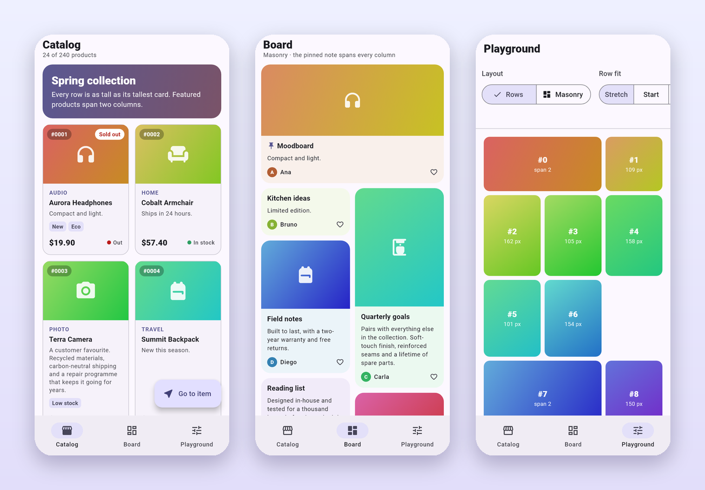
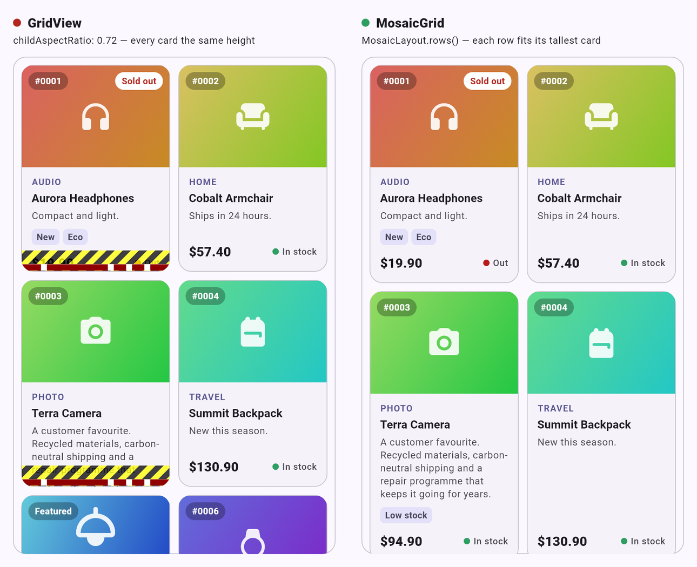
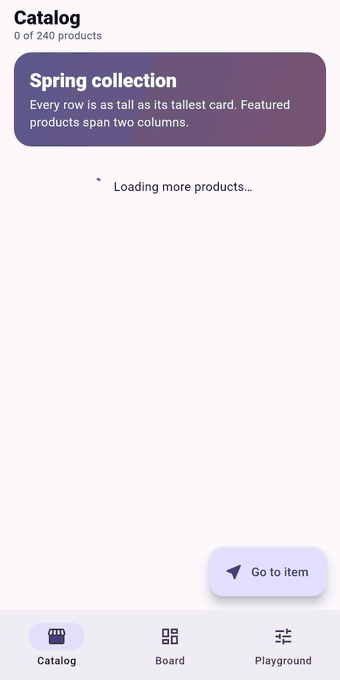
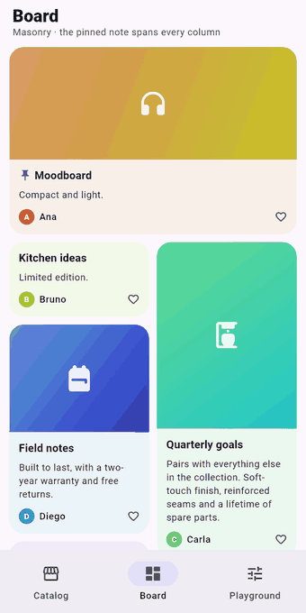
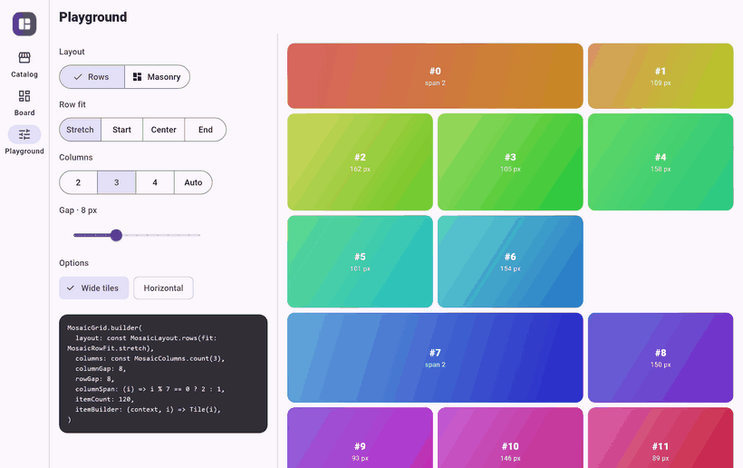
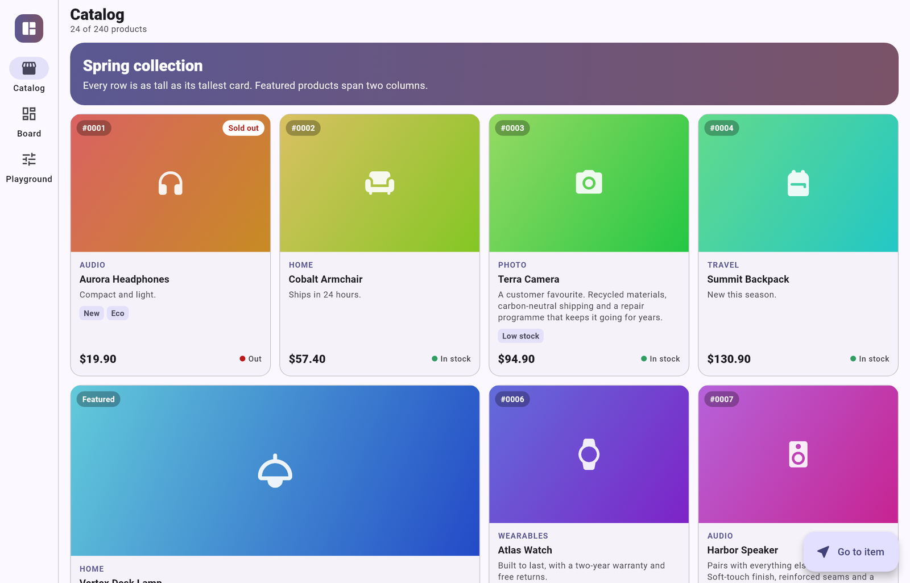
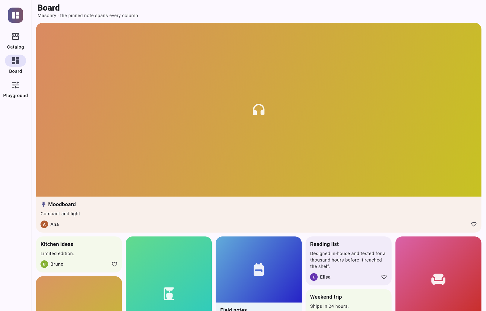
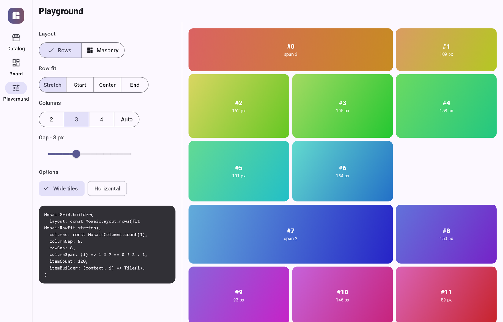

# mosaic_grid

[](https://pub.dev/packages/mosaic_grid)
[](https://github.com/Franklyn-R-Silva/mosaic_grid/actions/workflows/ci.yaml)
[](LICENSE)


**Lazy Flutter grids whose tiles size themselves.** Aligned rows that grow to
their tallest card, masonry columns, tiles that span several columns, paging
and jump-to-item — in one widget, with no dependencies beyond Flutter.

<p align="center">
  
</p>

---

## Why

`GridView` gives every tile the same height: you pick a `childAspectRatio` or
a `mainAxisExtent`, and whatever does not fit is cut off. Real cards do not
have a fixed height — a longer name, a promotion badge, a larger system font,
and the ratio that worked yesterday overflows today.

`MosaicGrid` gives each tile its column width and lets it choose its own
height. In the rows layout, every row is as tall as its tallest tile; in
masonry, every tile keeps its height and drops into the shortest column.
There is nothing to tune and nothing to cut off.

<p align="center">
  
</p>

## Features

- **Two layouts** — aligned rows (`MosaicLayout.rows`) and masonry
  (`MosaicLayout.masonry`).
- **Content-sized tiles** — no aspect ratio, no fixed extent. In rows, shorter
  tiles *stretch* to the row or sit at its *start*, *center* or *end*.
- **Multi-column tiles** — `columnSpan: (i) => ...`, in both layouts, built
  lazily like every other tile.
- **Responsive columns** — a fixed count, a minimum tile width with an optional
  cap, or a maximum tile width. Resolved from the space the grid actually has,
  so it works in split panes and resizable windows.
- **Jump to any item** — `MosaicController.jumpToIndex` / `animateToIndex`,
  exact even for items that were never on screen.
- **Paging built in** — `header`, `footer` and `onEndReached`, which asks for
  the next page once per approach to the end — also when a page is too short
  to fill the view.
- **Stable scrolling** — positions are recorded exactly, so scrolling back up
  never jumps; a tile above the viewport that changes size does not move what
  you are looking at.
- **Fast** — tiles are built on demand, and tiles already on screen are not
  laid out again while you scroll. No `IntrinsicHeight`.
- **Everywhere** — vertical and horizontal, right-to-left, `CustomScrollView`
  via `SliverMosaicGrid`, all six platforms.

## Contents

- [Install](#install)
- [Quick start](#quick-start)
- [Layouts](#layouts) — [rows](#rows) · [masonry](#masonry) · [spanning tiles](#spanning-tiles)
- [Columns](#columns)
- [Paging, header and footer](#paging-header-and-footer)
- [Jumping to an item](#jumping-to-an-item)
- [Inside a CustomScrollView](#inside-a-customscrollview)
- [API reference](#api-reference)
- [Tips](#tips)
- [How it works](#how-it-works)
- [Example app](#example-app)
- [Contributing](#contributing)

## Install

```bash
flutter pub add mosaic_grid
```

```dart
import 'package:mosaic_grid/mosaic_grid.dart';
```

Requires Flutter 3.32 or newer.

## Quick start

```dart
MosaicGrid.builder(
  columns: const MosaicColumns.minExtent(180, maxCount: 4),
  columnGap: 12,
  rowGap: 12,
  padding: const EdgeInsets.all(16),
  itemCount: products.length,
  itemBuilder: (context, i) => ProductCard(products[i]),
)
```

That is a complete, lazily built grid: as many columns as fit at 180 px or
more (up to four), and every row as tall as its tallest card.

## Layouts

### Rows

```dart
MosaicGrid.builder(
  layout: const MosaicLayout.rows(fit: MosaicRowFit.stretch), // the default
  ...
)
```

Tiles fill each row from the start edge. The row is as tall as its tallest
tile; `fit` decides what the others do with the spare room:

| `MosaicRowFit` | Shorter tiles… |
| --- | --- |
| `stretch` *(default)* | grow to the row's height — cards line up top and bottom |
| `start` | keep their height, at the start of the row |
| `center` | keep their height, centred in the row |
| `end` | keep their height, at the end of the row |

<p align="center">
  
</p>

### Masonry

```dart
MosaicGrid.builder(
  layout: const MosaicLayout.masonry(),
  columns: const MosaicColumns.minExtent(160, maxCount: 5),
  ...
)
```

Every tile keeps its own height and goes to the column that currently ends
first (the leftmost one on ties) — the Pinterest-style board.

<p align="center">
  
</p>

### Spanning tiles

```dart
MosaicGrid.builder(
  columnSpan: (i) => products[i].featured ? 2 : 1,
  ...
)
```

`columnSpan` is called with the item's index, before the tile is built, so
decide from your data. Spans below 1 count as 1; spans larger than the column
count take the whole row, so `(i) => i == 0 ? 99 : 1` is a full-width first
tile at any width.

- In **rows**, a tile that does not fit in what is left of the current row
  starts the next one.
- In **masonry**, a tile takes the run of columns whose tallest column ends
  first, and starts below it — so the shorter columns of that run keep a gap
  above it. Spans work best in masonry for tiles near the top, like a pinned
  full-width banner.

## Columns

```dart
columns: const MosaicColumns.count(3)                    // always 3
columns: const MosaicColumns.minExtent(180)              // every tile ≥ 180 px
columns: const MosaicColumns.minExtent(180, maxCount: 4) // …and at most 4 columns
columns: const MosaicColumns.maxExtent(320)              // every tile ≤ 320 px
```

| Constructor | Picks | Use it when |
| --- | --- | --- |
| `MosaicColumns.count(n)` | exactly `n` columns | the design has a fixed column count |
| `MosaicColumns.minExtent(e, maxCount: m)` | as many columns as fit with tiles at least `e` wide, capped at `m` | a tile has a minimum readable width |
| `MosaicColumns.maxExtent(e)` | the fewest columns that keep tiles at most `e` wide | tiles should not grow too wide |

The count is resolved on every layout from the grid's own cross-axis extent
(gaps included), not from the screen — the grid adapts inside a side panel
exactly as it does full screen. When the count changes, the item at the top
of the viewport stays where it was.

<p align="center">
  
</p>

## Paging, header and footer

```dart
MosaicGrid.builder(
  itemCount: products.length,
  itemBuilder: (context, i) => ProductCard(products[i]),
  header: const CatalogBanner(),
  footer: hasMore ? const LoadingRow() : const EndOfList(),
  onEndReached: loadNextPage,
  endReachedThreshold: 400, // px from the end; the default
)
```

- `header` and `footer` are full-width widgets that scroll with the tiles. The
  footer is the natural place for "loading more", "try again" or "that's all".
- `onEndReached` fires when the view comes within `endReachedThreshold` of the
  end: when the user scrolls there, or right away when a page — the first or
  any later one — is too short to fill the viewport.
- It does **not repeat while the view stays near the end with the same
  `itemCount`**: no duplicate calls while a page is loading, and no retry loop
  after a failed one. It fires again when `itemCount` changes, or when the user
  scrolls away from the end and comes back. It never fires while the grid is
  empty; loading the first page is up to you.
- To retry after a failed load, call your loader from the footer's button —
  or let the user scroll back to the end.

### Replacing the list

A new search or a new filter replaces the items instead of adding to them. If
the view is scrolled, it usually jumps back to the top and `onEndReached`
re-arms on its own. But a list replaced *in place*, with the same length and
the view still at the end — the first page of a new search, as long as the old
list was — looks exactly like the old one to the grid. Tell it what the items
were loaded for:

```dart
MosaicGrid.builder(
  itemCount: results.length,
  itemBuilder: (context, i) => ResultCard(results[i]),
  onEndReached: loadNextPage,
  endReachedKey: query, // a new query is a new list
)
```

When `endReachedKey` changes, the grid forgets that it already asked and checks
the end again.

## Jumping to an item

```dart
final mosaic = MosaicController();

MosaicGrid.builder(controller: mosaic, ...);

await mosaic.jumpToIndex(120);
await mosaic.animateToIndex(
  120,
  duration: const Duration(milliseconds: 600),
  curve: Curves.easeInOutCubic,
  alignment: 0.5, // 0 = leading edge, 0.5 = centre, 1 = trailing edge
);
```

The grid measures every item up to the target before scrolling, so the item
lands exactly where you asked even if it was never built. Far targets are
measured a slice per frame, so the app stays responsive on the way. Near the
ends of the grid, the scroll stops at the edge.

## Inside a CustomScrollView

`SliverMosaicGrid` is the same grid as a sliver, to mix with app bars, lists
and other slivers:

```dart
CustomScrollView(
  slivers: [
    const SliverAppBar.large(title: Text('Catalog')),
    SliverPadding(
      padding: const EdgeInsets.all(16),
      sliver: SliverMosaicGrid.builder(
        columns: const MosaicColumns.minExtent(180),
        columnGap: 12,
        rowGap: 12,
        controller: mosaic, // works here too
        itemCount: products.length,
        itemBuilder: (context, i) => ProductCard(products[i]),
      ),
    ),
  ],
)
```

`MosaicController` accounts for the slivers before the grid.

## API reference

### `MosaicGrid`

A scroll view. `MosaicGrid.builder(...)` builds tiles on demand;
`MosaicGrid(children: [...])` takes a ready list (fine for short grids — every
child is kept in memory).

| Parameter | Type | Default | Description |
| --- | --- | --- | --- |
| `itemCount` | `int` | *required* (builder) | Number of items. |
| `itemBuilder` | `IndexedWidgetBuilder` | *required* (builder) | Builds the tile for an index. |
| `children` | `List<Widget>` | *required* (default constructor) | The tiles. |
| `columns` | `MosaicColumns` | `count(2)` | How many columns. See [Columns](#columns). |
| `layout` | `MosaicLayout` | `rows()` | Rows or masonry. See [Layouts](#layouts). |
| `columnGap` | `double` | `0` | Gap between columns. |
| `rowGap` | `double` | `0` | Gap between tiles along the scroll axis. |
| `columnSpan` | `int Function(int index)?` | `null` (1 each) | Columns each item spans. |
| `header` | `Widget?` | `null` | Full-width widget before the tiles. |
| `footer` | `Widget?` | `null` | Full-width widget after the tiles. |
| `onEndReached` | `VoidCallback?` | `null` | Called when the view comes near the end, once per approach. See [Paging](#paging-header-and-footer). |
| `endReachedThreshold` | `double` | `400` | Distance from the end that triggers `onEndReached`. |
| `endReachedKey` | `Object?` | `null` | What the items were loaded for; a new value re-arms `onEndReached`. See [Replacing the list](#replacing-the-list). |
| `controller` | `MosaicController?` | `null` | Jump or animate to an item. |
| `findItemIndexCallback` | `ChildIndexGetter?` | `null` | Keeps tile state when items are reordered (by key). |
| `scrollController` | `ScrollController?` | `null` | The scroll position. |
| `scrollDirection` | `Axis` | `vertical` | Scroll axis. |
| `reverse` | `bool` | `false` | Scroll from the end. |
| `primary` | `bool?` | `null` | See `ScrollView.primary`. |
| `physics` | `ScrollPhysics?` | `null` | Scroll physics. |
| `shrinkWrap` | `bool` | `false` | Size to content (lays out every tile; keep it for short grids). |
| `padding` | `EdgeInsetsGeometry?` | `MediaQuery` padding | Space around header, tiles and footer. |
| `addAutomaticKeepAlives` | `bool` | `true` | Wrap tiles in `AutomaticKeepAlive`. |
| `addRepaintBoundaries` | `bool` | `true` | Wrap tiles in `RepaintBoundary`. |
| `addSemanticIndexes` | `bool` | `true` | Wrap tiles in `IndexedSemantics`. |
| `keyboardDismissBehavior` | `ScrollViewKeyboardDismissBehavior?` | `null` | See `ScrollView`. |
| `dragStartBehavior` | `DragStartBehavior` | `start` | See `ScrollView`. |
| `restorationId` | `String?` | `null` | Restores the scroll offset. |
| `clipBehavior` | `Clip` | `hardEdge` | Viewport clipping. |

### `SliverMosaicGrid`

The sliver version, with the grid parameters of `MosaicGrid`:
`itemCount`/`itemBuilder` (or `children`), `columns`, `layout`, `columnGap`,
`rowGap`, `columnSpan`, `controller`, `findItemIndexCallback`,
`addAutomaticKeepAlives`, `addRepaintBoundaries`, `addSemanticIndexes`.

### `MosaicLayout`

| Constructor | Description |
| --- | --- |
| `MosaicLayout.rows({MosaicRowFit fit = MosaicRowFit.stretch})` | Aligned rows, each as tall as its tallest tile. |
| `MosaicLayout.masonry()` | Free-height tiles in the column that ends first. |

`MosaicRowFit`: `stretch`, `start`, `center`, `end` — see [Rows](#rows).

### `MosaicColumns`

| Constructor | Description |
| --- | --- |
| `MosaicColumns.count(int count)` | Exactly `count` columns. |
| `MosaicColumns.minExtent(double minExtent, {int? maxCount})` | As many columns as fit with tiles at least `minExtent` wide, at most `maxCount`. |
| `MosaicColumns.maxExtent(double maxExtent)` | The fewest columns that keep tiles at most `maxExtent` wide. |

`resolve(crossAxisExtent, gap)` returns the count for a given width, if you
need it elsewhere in your layout.

### `MosaicController`

| Member | Description |
| --- | --- |
| `jumpToIndex(int index, {double alignment = 0})` | Scrolls to `index` without animation. |
| `animateToIndex(int index, {required Duration duration, Curve curve = Curves.easeInOut, double alignment = 0})` | Animates to `index`. |
| `isAttached` | Whether a grid is using the controller. |

Both methods complete once the item is in place, and do nothing when no grid
is attached. A controller drives one grid at a time; when a grid replaces
another with the same controller (a new `key`, an `AnimatedSwitcher`), it
drives the new one. A drag by the user stops an `animateToIndex` in progress.

`MosaicSpanCallback` is the type of `columnSpan`: `int Function(int index)`.

## Tips

**Pin content to the bottom of a stretched card with `spaceBetween`, not
`Spacer`.** The grid measures each tile with an unbounded height before it
stretches it, and `Expanded`/`Spacer` along the scroll axis cannot be
measured that way. `MainAxisAlignment.spaceBetween` does nothing in the
measuring pass and pushes the last child down once the tile is stretched:

```dart
Column(
  crossAxisAlignment: CrossAxisAlignment.stretch,
  mainAxisAlignment: MainAxisAlignment.spaceBetween,
  children: [
    ProductDetails(product), // top
    PriceRow(product),       // pinned to the bottom of the row
  ],
)
```

`Expanded` and `Spacer` inside a `Row` (across the tile) are fine.

**Give tiles keys when the list can be reordered or filtered**, and pass
`findItemIndexCallback`, so tiles keep their state instead of being rebuilt
at a new index.

**Tiles can change size.** A tile that grows or shrinks (an expanding
section, an image that loads) re-flows the grid from that tile on. If it is
above the viewport, the grid adjusts the scroll offset so what you are
looking at does not move.

**Long jumps fill in over a few frames.** Positions come from measuring items
in order, so dragging the scrollbar to the end of a 100,000-item grid, or a
`scrollController.jumpTo` far ahead, has to measure everything in between. The
grid spends at most about 12 ms per frame on it and fills the new area in as
it goes — the app never freezes. To land on a specific item, use
`MosaicController`, which also waits for the exact position.

**Changing columns deep in a list is cheap.** When the column count, the row
gap or the layout changes — a phone rotates, a window crosses a breakpoint —
the grid places the items above the view from the sizes it already recorded
instead of building them again. With new column widths those are the old
sizes until each tile scrolls back into view and is measured again; the grid
corrects the scroll offset as it goes, so what you are looking at does not
move.

**Horizontal grids** work the same way: columns become rows across the height,
and tiles choose their own width.

## How it works

Many lazy grids either fix every tile's size up front or rebuild positions
backwards when you scroll up, which is where drift and jumps come from.
`mosaic_grid` keeps a **ledger**: a record, in index order from the first
item, of the columns each item occupies and exactly where its slot starts and
ends. The ledger only ever grows forward from item 0, so every position in it
is exact — scrolling up reads it back instead of guessing, and
`jumpToIndex` can go straight to a recorded item.

Each tile is wrapped in a small render object that measures its child's
natural height and, in stretched rows, lays it out a second time at the row's
height. The row height travels inside the layout constraints, so a tile whose
row did not change is skipped entirely while you scroll.

## Example app

The [example](example/lib/main.dart) is a small gallery — a paged product
catalog, a masonry board, and a playground that shows every option with the
code that produces it:

```bash
cd example
flutter run
```

<p align="center">
  
</p>

<details>
<summary>Desktop screenshots</summary>

<p align="center">
  
  
  
</p>

</details>

Every image in this README is rendered from the example app by a script, so
they always match the code — see [tool/build_media.py](tool/build_media.py).

## Contributing

Issues and pull requests are welcome — see [CONTRIBUTING.md](CONTRIBUTING.md).
Before sending a change:

```bash
dart format .
flutter analyze
flutter test
```

## License

[MIT](LICENSE) © Franklyn R. Silva
